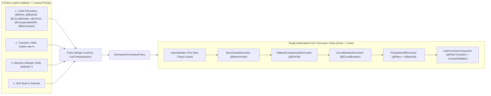
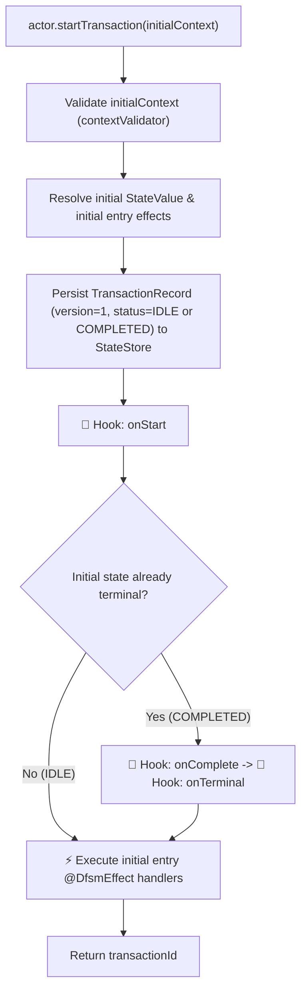

# DFSM (`eklabdev/dfsm`) — Durable Finite State Machine

**DFSM** is a polyglot, XState-aligned **Durable Finite State Machine** and Saga workflow orchestration framework. Define statecharts once using a shared canonical YAML specification (`dfsm: "1.0"`) — or programmatically via a fluent `MachineBuilder` — and run durable, resilient transactions across **TypeScript**, **Java**, **C#**, **Go**, and **Rust**, backed by an interactive **VS Code Extension**.

## Core Capabilities

- **XState-Aligned Statecharts**: Standalone (atomic) states, hierarchical parent/child compound states (with event bubbling and ordered `exit`/`entry` effects), orthogonal `parallel` regions (`onDone` synchronization), and a built-in default `error` state (overridable per machine).
- **Code-First Typed Generics & Validation**: YAML defines clean topology and resilience rules, while host source code owns generic `<TContext, TInput, TOutput>` types and native validation (Zod, Jakarta Bean Validation, DataAnnotations/FluentValidation, Go `validator`, Rust `validator`).
- **Composable Decorator Pattern & Deduplicated Policy Merging**: Annotate or wrap custom transition functions with `@DfsmTransition`, `@Retry`, `@Backoff`, `@CircuitBreaker`, `@OnFail`, `@CompensateWith`, and `@Benchmark`. Policies declared in code decorators and YAML normalize into a single deduplicated pipeline (`Code Decorator > Transition YAML > Machine Defaults > SDK Default`).
- **Durable Multi-Actor Runtime & Saga Compensation Stack**: Multiple typed `DfsmActor<TContext>` instances coexist with isolated machines, persisting every transaction step and LIFO compensation entry to embedded in-memory SQL databases out of the box (SQLite `:memory:` / H2) or production **PostgreSQL** and **MongoDB** stores.
- **Crash Recovery, Scheduler & Operational Introspection**: Configurable startup and periodic background sweeps (`STOP`, `MARK_FAIL`, `DELETE`, `COMPENSATE`, `CONTINUE`), live in-flight transaction queries, effective policy inspection, and optimistic-lock-safe `forceCleanUp`.
- **VS Code Extension (`eklabdev.vscode-dfsm`)**: Automatic `.dfsm.yaml` / `dfsm: "1.0"` recognition, JSON Schema IntelliSense, custom AST diagnostics, and a live two-way synced Statechart Visualizer Webview.

---

## Execution Lifecycle: Transitions, Decorators, Hooks & Effects

Every DFSM SDK executes transactions, GoF resilience decorators, Saga compensations, lifecycle hooks (`@DfsmHook` / `hooks:`), and effects (`@DfsmEffect` / `entry` / `exit` / `effects`) in a **strictly deterministic, causal order**.

### 1. Policy Normalization & Decorator Wrapping Architecture

Before any transaction runs, policies declared across **Code Decorators**, **Transition YAML**, **Machine `defaults:` YAML**, and **SDK Defaults** are leaf-merged into a single deduplicated `NormalizedTransitionPolicy` (`Code Decorator > Transition YAML > Machine Defaults > SDK Default`) and materialized into **exactly one** decorator wrapper per capability:

---

### 2. End-to-End Transaction, Hook, Compensation & Effect Flow

#### Phase A — `actor.startTransaction(initialContext)`

#### Phase B — `actor.transition(transactionId, event, input)`

```mermaid
flowchart TD
  Call["actor.transition(txId, event, input)"] --> LoadSnap["Load TransactionSnapshot from StateStore"]
  LoadSnap --> Match{"Match event on active leaf -> bubble up ancestors?"}
  Match -- "No match" --> ErrInvalid["Throw InvalidTransitionError (State unchanged, no hooks/retries)"]

  Match -- "Matched" --> ValInput{"1. InputValidator (TInput schema)"}
  ValInput -- "Invalid payload" --> ErrVal["Throw ValidationError (State unchanged, no retries/CB/hooks)"]

  ValInput -- "Valid" --> HookBefore["🔔 Hook: beforeTransition"]
  HookBefore --> Lease["Persist status = IN_FLIGHT + activeStep lease in StateStore"]

  Lease --> BenchStart["2. BenchmarkDecorator: Start timer (t0)"]
  BenchStart --> FallbackWrap["3. FallbackCompensateDecorator: Arm @OnFail catch boundary"]
  FallbackWrap --> CBCheck{"4. CircuitBreakerDecorator: Circuit state?"}

  CBCheck -- "OPEN" --> CBErr["Throw CircuitOpenError (Short-circuit)"]
  CBCheck -- "CLOSED / HALF_OPEN" --> RetryLoop["5. RetryBackoffDecorator: Attempt 1..maxAttempts"]

  RetryLoop --> UserFn["6. @DfsmTransition(req) -> Validate next TContext (contextValidator)"]
  UserFn -- "Throws & attempt < maxAttempts" --> Backoff["Sleep Backoff (fixed | linear | exponential | exponential_jitter)"]
  Backoff --> RetryLoop

  UserFn -- "Throws on final attempt" --> CBRecordFail["CircuitBreaker records failure"]
  CBRecordFail --> FallbackCatch
  CBErr --> FallbackCatch["FallbackCompensateDecorator catches error -> resolves onFail.compensate & onFail.target"]

  %% SUCCESS BRANCH
  UserFn -- "Succeeds" --> CBRecordOk["CircuitBreaker records success"]
  CBRecordOk --> ApplyTarget["Compute LCA -> Queue exit effects, transition/output effects, entry effects + @CompensateWith entry"]
  ApplyTarget --> OnDoneCheck["Cascade automatic onDone transitions (compound / parallel final sync)"]
  OnDoneCheck --> BenchOk["BenchmarkDecorator logs SUCCESS telemetry"]
  BenchOk --> CommitOk["Atomic StateStore Commit: next stateValue, context, status (IDLE | COMPLETED) + push CompensationEntry"]

  %% FAILURE & SAGA COMPENSATION BRANCH
  FallbackCatch --> WantComp{"onFail.compensate == true?"}
  WantComp -- "Yes" --> MarkComp["Persist status = COMPENSATING in StateStore"]
  MarkComp --> UnwindLoop["Unwind Saga Stack in strict LIFO order (stepSeq DESC): run @DfsmCompensate"]
  UnwindLoop --> MarkStepComp["Mark step compensated in StateStore -> 🔔 Hook: onCompensate (per step)"]
  MarkStepComp --> ApplyFallback["Transition to onFail.target (default 'error') & queue fallback exit/entry effects"]
  WantComp -- "No" --> ApplyFallback

  ApplyFallback --> BenchFail["BenchmarkDecorator logs COMPENSATED / FALLBACK / FAILED telemetry"]
  BenchFail --> CommitFail["Atomic StateStore Commit: fallback stateValue, context, status (COMPENSATED | FAILED | IDLE)"]

  %% POST-COMMIT HOOKS & EFFECTS
  CommitOk --> HookAfter["🔔 Hook: afterTransition (State & context already durable in DB)"]
  CommitFail --> HookAfter

  HookAfter --> CheckComplete{"status == COMPLETED?"}
  CheckComplete -- "Yes" --> HookComplete["🔔 Hook: onComplete"]
  HookComplete --> HookTerminal["🔔 Hook: onTerminal"]
  CheckComplete -- "No" --> CheckTerm{"status in [COMPENSATED, FAILED]?"}
  CheckTerm -- "Yes" --> HookTerminal
  CheckTerm -- "No (IDLE)" --> RunEffects

  HookTerminal --> RunEffects["⚡ Execute Post-Commit @DfsmEffect Queue (exit -> transition/output -> entry)"]
  RunEffects --> EffectRouter{"Effect calls req.runEffect(...) or req.actor.transition(...)?"}
  EffectRouter -- "Yes (depth <= maxEffectChainDepth)" --> ChainedTx["Run sub-effect / nested actor.transition(...) -> Refresh final settled snapshot"]
  EffectRouter -- "No" --> ReturnRes["Return TransitionExecutionResult"]
  ChainedTx --> ReturnRes
```

---

### 3. Exact Trigger Reference: Hooks, Decorators & Effects

#### Lifecycle Hooks (`hooks:` in YAML / `@DfsmHook` / `ActorLifecycleHooks`)
Within each hook slot, subscribers execute in deterministic order:
**`Global FSMRegistry Hooks` → `Machine YAML / Builder @DfsmHook` → `ActorConfig.hooks` → `actor.addHooks()`**.

| Hook | Exact Trigger Moment | `StateStore` State When Fired | Fires On |
| :--- | :--- | :--- | :--- |
| **`onStart`** | Immediately after `startTransaction()` persists the initial record (and **before** initial `entry` effects run). | Initial state & `version = 1` committed (`IDLE` or `COMPLETED`). | Every new transaction |
| **`beforeTransition`** | After event matching and `InputValidator` succeed, **before** acquiring the `IN_FLIGHT` lease or running `@DfsmTransition`. | Previous settled state (`IDLE`). Skipped if event is invalid or `TInput` fails validation. | Every valid transition call |
| **`onCompensate`** | Inside the Saga rollback loop (`status = COMPENSATING`), immediately after **each** LIFO `@DfsmCompensate` step finishes and is marked compensated in DB. | Step marked `compensatedAt` in `StateStore` (fires `N` times for `N` rolled-back steps). | Only when transition fails & `onFail.compensate: true` |
| **`afterTransition`** | Immediately after the step's resulting `stateValue`, `context`, and settled `status` commit to `StateStore` (**before** post-commit `@DfsmEffect`s run, keeping chained auto-transitions strictly chronological). | Final step state committed (`IDLE`, `COMPLETED`, `COMPENSATED`, or `FAILED`). | Every executed transition (both success & handled failure) |
| **`onComplete`** | Immediately after `afterTransition` when the root machine reaches a non-`error` `type: final` state. | `status === "COMPLETED"` committed. | Happy-path completion only |
| **`onTerminal`** | Immediately after `afterTransition` (and after `onComplete` if `COMPLETED`) whenever the transaction enters **any** terminal status. | `status` is `"COMPLETED"`, `"COMPENSATED"`, or `"FAILED"`. | All terminal outcomes (success, compensated, or failed) |

#### Decorators & Effects Summary

| Decorator / Construct | Role & Execution Timing | Failure / Rollback Behavior |
| :--- | :--- | :--- |
| **`@DfsmTransition` (`inputValidator`)** | Validates caller `TInput` **pre-flight** before `beforeTransition` or `IN_FLIGHT` lease. | Throws `ValidationError` immediately (`400`); **never** retries, trips CB, or compensates. |
| **`@Benchmark`** | Outermost pipeline wrapper; measures wall-clock latency across retries + compensation and writes to `BenchmarkLogEngine`. | Logs `SUCCESS`, `COMPENSATED`, `FALLBACK`, or `FAILED`. |
| **`@OnFail`** | Catches terminal runtime errors escaping `@CircuitBreaker` / `@Retry` and selects `compensate: boolean` + fallback `target` (default `"error"`). | Transitions transaction to `onFail.target` instead of leaving transaction stuck `IN_FLIGHT`. |
| **`@CircuitBreaker`** | Tracks sliding-window failure count across transactions on the actor; short-circuits with `CircuitOpenError` while `OPEN`. | Treated as a runtime step failure by `@OnFail` (triggers fallback / compensation without calling handler). |
| **`@Retry` + `@Backoff`** | Innermost wrapper around `@DfsmTransition`; retries runtime/context errors up to `maxAttempts` with backoff delay. | Clones `context.data` per attempt so failed attempts never pollute subsequent retries. |
| **`@CompensateWith` / `@DfsmCompensate`** | Pushed to durable Saga stack when its paired `@DfsmTransition` commits; executed in **LIFO** order during rollback. | Updates `TContext` step-by-step and emits `onCompensate` per entry. |
| **`@DfsmEffect` (`exit` / `effects` / `entry`)** | Runs **post-commit** in order `exit` (bottom-up to LCA) → transition/output `effects` → `entry` (top-down from LCA). | Receives `req.actor` & `req.runEffect(...)` to conditionally route (`if / else`) and trigger automatic next transitions (guarded by `maxEffectChainDepth`). |

---

## Repository Structure

| Path | Description | Status |
| :--- | :--- | :--- |
| [`spec/`](./spec) | Canonical `SPECIFICATION.md`, `dfsm-v1.schema.json`, and cross-language conformance test vectors | Canonical Spec |
| [`tools/vscode-dfsm/`](./tools/vscode-dfsm) | VS Code Extension (`eklabdev.vscode-dfsm`) for YAML authoring, diagnostics, and visualization | Complete & Verified |
| [`sdks/typescript/`](./sdks/typescript) | TypeScript / Node.js SDK (`@eklabdev/dfsm`) + 6 progressive examples (incl. Express REST API + Postman) + npm packaging | Complete & Verified |
| [`sdks/java/`](./sdks/java) | Java 17+ SDK (`io.github.eklabdev:dfsm-core`) — H2, PostgreSQL, MongoDB, Spring Boot REST API + Postman, Maven Central guide | Complete & Verified |
| [`sdks/csharp/`](./sdks/csharp) | C# / .NET SDK (`EKLabDev.Dfsm`) — SQLite, PostgreSQL, MongoDB, ASP.NET Core Minimal API + Postman, NuGet packaging | Complete & Verified |
| [`sdks/go/`](./sdks/go) | Go SDK (`github.com/eklabdev/dfsm/sdks/go`) — Memory, PostgreSQL, MongoDB, HTTP REST API + Postman | Complete & Verified |
| [`sdks/rust/`](./sdks/rust) | Rust SDK (`eklabdev-dfsm`) — Memory & pluggable stores, Axum REST API + Postman, Cargo packaging | Complete & Verified |
| [`infra/`](./infra) | `docker-compose.yml` for PostgreSQL 17 and MongoDB 8.0 integration testing | Active |

---

## Polyglot Conformance Matrix

Every DFSM SDK is verified against the canonical conformance test suite (`spec/conformance/conformance-suite.json`) and delivers 100% semantic and behavioral parity:

| Feature / Capability | TypeScript (`@eklabdev/dfsm`) | Java (`dfsm-core`) | C# (`EKLabDev.Dfsm`) | Go (`dfsm/sdks/go`) | Rust (`eklabdev-dfsm`) |
| :--- | :---: | :---: | :---: | :---: | :---: |
| **Canonical YAML AST (`dfsm: "1.0"`)** | ✅ | ✅ | ✅ | ✅ | ✅ |
| **JSON Schema Draft 2020-12 Validation** | ✅ (`ajv`) | ✅ (`networknt`) | ✅ (`JsonSchema.Net`) | ✅ (`santhosh-tekuri`) | ✅ (`jsonschema`) |
| **Compound States & Bubbling** | ✅ | ✅ | ✅ | ✅ | ✅ |
| **Parallel Regions & `onDone` Synchronization** | ✅ | ✅ | ✅ | ✅ | ✅ |
| **4-Layer Policy Merging Precedence** | ✅ | ✅ | ✅ | ✅ | ✅ |
| **Non-multiplying Exponential Retries & Jitter** | ✅ | ✅ | ✅ | ✅ | ✅ |
| **Sliding-Window Circuit Breaker** | ✅ | ✅ | ✅ | ✅ | ✅ |
| **LIFO Saga Compensation Rollback** | ✅ | ✅ | ✅ | ✅ | ✅ |
| **6-Hook Lifecycle Pipeline** | ✅ | ✅ | ✅ | ✅ | ✅ |
| **Conditional Effect Routing & Recursion Guards** | ✅ | ✅ | ✅ | ✅ | ✅ |
| **In-Memory State Store** | ✅ (SQLite `:memory:`) | ✅ (H2 In-Memory) | ✅ (SQLite In-Memory) | ✅ (MemoryStateStore) | ✅ (MemoryStateStore) |
| **PostgreSQL Durable Store** | ✅ | ✅ | ✅ | ✅ | Extensible `StateStore` |
| **MongoDB Durable Store** | ✅ | ✅ | ✅ | ✅ | Extensible `StateStore` |
| **Multi-Actor Monitoring & Cleanup Sweeps** | ✅ | ✅ | ✅ | ✅ | ✅ |
| **5 Progressive Examples (`01`–`05`)** | ✅ | ✅ | ✅ | ✅ | ✅ |
| **Example 06 REST API Server** | Express | Spring Boot | ASP.NET Core | `net/http` | Axum |
| **Postman v2.1 Collection (`{{orderId}}`)** | ✅ | ✅ | ✅ | ✅ | ✅ |
| **Request & Step/Hook Observability Logs** | ✅ | ✅ | ✅ | ✅ | ✅ |
| **Canonical Conformance Suite (6/6 Pass)** | 6 / 6 | 6 / 6 | 6 / 6 | 6 / 6 | 6 / 6 |

