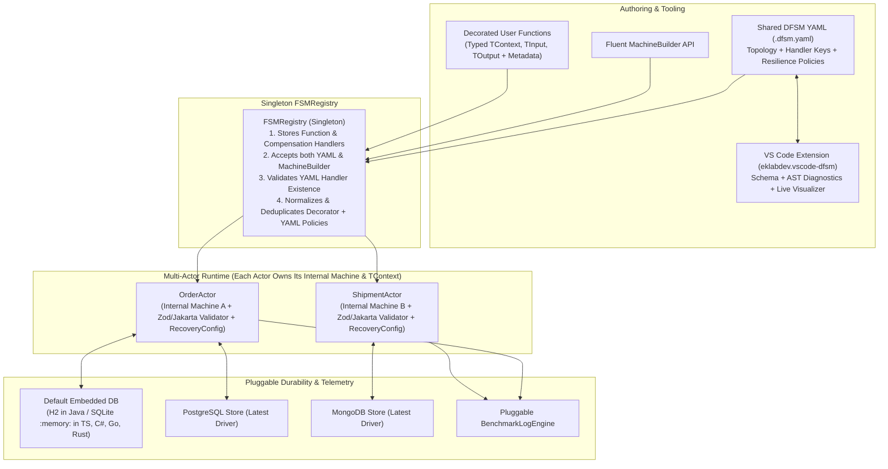
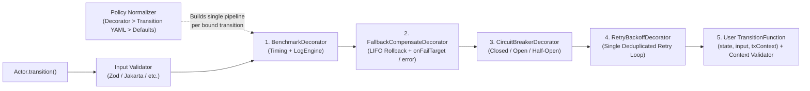
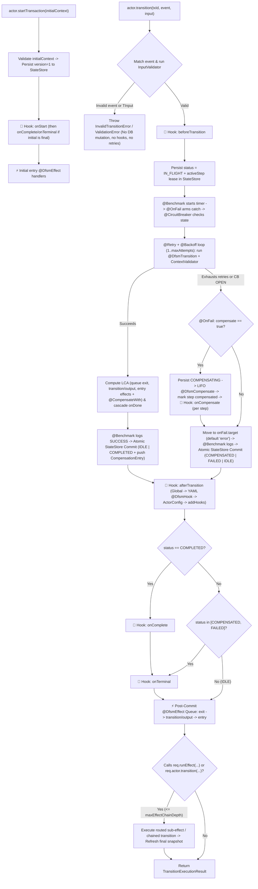

# DFSM (Durable Finite State Machine) — Architecture & Delivery Plan

## 1. Executive Summary & Architectural Vision

**DFSM (`eklabdev/dfsm`)** is a polyglot, durable workflow orchestration engine built around **XState-aligned hierarchical and parallel statecharts**. A single canonical YAML definition (`dfsm: "1.0"`) — or an equivalent programmatic `MachineBuilder` — drives execution consistently across **5 core language SDKs** (**TypeScript**, **Java**, **C#**, **Go**, and **Rust**), backed by embedded in-memory databases out of the box (H2 / SQLite `:memory:`) and pluggable production stores (**PostgreSQL** and **MongoDB**), alongside a dedicated **VS Code Extension** for authoring, schema validation, and live statechart visualization.

> [!IMPORTANT]
> **Current Active Wave — Wave 2 (Java SDK `io.github.eklabdev:dfsm-core`)**: **Wave 1** (Canonical Spec & Conformance Suite + TypeScript SDK `@eklabdev/dfsm` + Express E2E API Sample & Postman Collection + VS Code Extension `eklabdev.vscode-dfsm`) is **completed and verified**. All Wave 2–4 SDKs (**Java**, **C#**, **Go**, **Rust**) implement the exact finalized v1.0 contract below.



---

## 2. Namespace & Monorepo Structure (`eklabdev/dfsm`)

### 2.1 Ecosystem Package Coordinates
| Target | Package / Module Identifier | Registry |
| :--- | :--- | :--- |
| **Repository / Go** | `github.com/eklabdev/dfsm` | `pkg.go.dev` |
| **TypeScript** | `@eklabdev/dfsm` | npm |
| **VS Code Plugin** | `eklabdev.vscode-dfsm` | VS Code Marketplace |
| **Java** | `io.github.eklabdev:dfsm-core` *(or `dev.eklab.dfsm` — see Section 9)* | Maven Central / Artifactory |
| **C# (.NET)** | `EKLabDev.Dfsm` | NuGet |
| **Rust** | `eklabdev-dfsm` (`eklabdev-dfsm-macros`) | crates.io |

### 2.2 Monorepo Layout
```text
dfsm/
├── spec/
│   ├── SPECIFICATION.md                # Formal statechart, policy-merge, saga, & durability rules
│   ├── dfsm-v1.schema.json             # Canonical JSON Schema (Draft 2020-12)
│   └── conformance/                    # Cross-language YAML + JSON test vectors
├── sdks/
│   ├── typescript/                     # @eklabdev/dfsm (Wave 1)
│   ├── java/                           # io.github.eklabdev:dfsm (Wave 2)
│   ├── csharp/                         # EKLabDev.Dfsm (Wave 3)
│   ├── go/                             # github.com/eklabdev/dfsm/sdks/go (Wave 4)
│   └── rust/                           # eklabdev-dfsm Cargo workspace (Wave 4)
├── tools/
│   └── vscode-dfsm/                    # VS Code plugin: YAML intelligence + visualizer (Wave 1)
└── infra/
    └── docker-compose.yml              # Latest PostgreSQL + MongoDB containers for integration tests
```

---

## 3. Canonical YAML Specification (`dfsm: "1.0"`) & Code-First Typed Context

### 3.1 Separation of Concerns: YAML Topology vs. Code-Defined Generics & Validation
- **YAML owns**: State hierarchy (standalone, parent/child, parallel, default/overridden `error`), event routing, handler lookup keys in `FSMRegistry`, and declarative default/per-transition resilience policies.
- **Source Code owns `TContext`, `TInput`, and `TOutput`**: YAML intentionally **does not** embed untyped `context` data blobs. Instead, developers define strongly typed classes/interfaces/structs in code and attach native validators:
  - **TypeScript**: `Actor<OrderContext>` & `@DfsmTransition<OrderContext, ChargeInput, ChargeReceipt>` with first-class `SchemaValidator<T>` adapters for **Zod** (standard `safeParse` / Standard Schema) or custom validators.
  - **Java**: `DfsmActor<OrderContext>` with **Jakarta Bean Validation** (`jakarta.validation.Validator` — `@NotNull`, `@Positive`, `@Valid`) + Jackson typed hydration.
  - **C#**: `DfsmActor<OrderContext>` with **DataAnnotations** / **FluentValidation** + `System.Text.Json`.
  - **Go**: `dfsm.Actor[OrderContext]` with **`go-playground/validator`** struct tags / `Validate() error`.
  - **Rust**: `DfsmActor<OrderContext>` with **`serde`** + **`validator`** (`#[derive(Validate)]`).

### 3.2 XState-Aligned State Taxonomy
1. **Standalone (Atomic) State**: Leaf state with `entry`, `exit`, and `on` transitions.
2. **Parent (Compound) & Child States**: Nested `initial` + `states`. Events evaluate on the deepest active child first and **bubble up** to parent states if unhandled; `exit` runs bottom-up and `entry` runs top-down.
3. **Parallel (Orthogonal) State**: `type: parallel` activating all child regions simultaneously, supporting `onDone` when every child region reaches a `type: final` state.
4. **Default Overridable `error` State**: Every machine automatically injects a top-level `error` state (`type: final`) unless explicitly overridden under `states.error` in YAML or `.errorState(...)` in `MachineBuilder`.

### 3.3 Canonical YAML Example (Clean, Context-Free, Registry-Verified)

```yaml
# yaml-language-server: $schema=https://raw.githubusercontent.com/eklabdev/dfsm/main/spec/dfsm-v1.schema.json
dfsm: "1.0"
id: order-checkout
version: "1.0.0"
initial: validating

# Configures where transition, compensation, effect, & hook functions are looked up in Singleton FSMRegistry.
# All referenced functions MUST be registered in FSMRegistry (or passed via inline `bindings` on machine creation) when strict: true.
registry:
  namespace: "orders.checkout"
  strict: true

# Maximum nested effect / automatic transition chain depth per transaction (default 25)
maxEffectChainDepth: 25

# Sub-effects invoked dynamically via EffectRequest.runEffect(...) inside conditional @DfsmEffect routers
effects:
  - fastTrackWalletSubEffect

# Machine-level Transaction Lifecycle Hooks resolved from FSMRegistry (@DfsmHook / decorateHook)
hooks:
  onStart: onCheckoutStart
  beforeTransition: onBeforeCheckoutStep
  afterTransition: [auditCheckoutStep, recordCheckoutMetrics]
  onCompensate: onCheckoutStepCompensated
  onComplete: onCheckoutCompleted
  onTerminal: onCheckoutTerminal

# Machine-level resilience defaults (merged with per-transition YAML & code decorators; code decorator wins)
defaults:
  retry:
    maxAttempts: 3
    backoff:
      strategy: exponential_jitter # fixed | linear | exponential | exponential_jitter
      initialDelayMs: 100
      maxDelayMs: 5000
      multiplier: 2.0
  circuitBreaker:
    enabled: true
    failureThreshold: 5
    slidingWindowSize: 10
    openDurationMs: 30000
    halfOpenMaxCalls: 2
  onFail:
    compensate: true
    target: error # Defaults to top-level 'error' state if omitted
  benchmark:
    enabled: true

states:
  validating:
    on:
      SUBMIT:
        target: processing
        transition: validateOrder          # Must exist in FSMRegistry as 'orders.checkout.validateOrder'
        compensate: cancelValidation       # Pushed to transaction's compensation stack on success

  processing:
    type: parallel
    onDone:
      target: completed
    states:
      payment:
        initial: charging
        states:
          charging:
            on:
              CHARGE_CARD:
                target: charged
                transition: chargeCard
                compensate: refundCard
                retry:
                  maxAttempts: 3           # If @Retry(4) decorator is on 'chargeCard', effective = 4!
                onFail:
                  compensate: true
                  target: "#order-checkout.payment_review"
          charged:
            type: final
      inventory:
        initial: reserving
        states:
          reserving:
            on:
              RESERVE_STOCK:
                target: reserved
                transition: reserveStock
                compensate: releaseStock
          reserved:
            type: final

  payment_review:
    on:
      APPROVE_MANUAL:
        target: completed
        transition: manualApprove
      ABORT:
        target: error

  completed:
    type: final

  # Optional override of the built-in default 'error' state
  error:
    entry: [notifyOpsEffect]
    on:
      RESET:
        target: validating
```

---

## 4. Core Runtime Design

### 4.1 Multi-Actor Architecture & Singleton `FSMRegistry`
- **Confirmed Multi-Actor Model**: An application can instantiate **any number of `DfsmActor<TContext>` instances concurrently**. Each `Actor` owns its **own bound internal compiled machine instance**, its own `actorId`, its own generic `TContext` codec/validator, its own `StateStore` reference (defaulting to the registry's embedded DB store or overridden per actor), and its own `InFlightRecoveryConfig`.
- **Dual Machine Authoring in `FSMRegistry`**:
  - `FSMRegistry.getInstance()` accepts **both** `registerYaml(yamlStringOrPath)` and `registerBuilder(machineBuilder)` (which compile to the exact same internal `MachineDefinition` AST).
  - **Strict YAML Handler Verification**: When binding a YAML-defined machine, `FSMRegistry` verifies that every referenced `transition`, `compensate`, and `effect` function key has been registered in `FSMRegistry`. Missing handlers fail fast at startup with a descriptive `UnregisteredHandlerError`.
- **Transaction Lifecycle**:
  - `txId = await orderActor.startTransaction(initialOrderContext, customTxId?)` validates `initialOrderContext`, resolves the initial state tree (including nested/parallel initial states), and **immediately persists the initial transaction record** to `StateStore`.
  - `result = await orderActor.transition<ChargeInput, ChargeOutput>(txId, "CHARGE_CARD", chargeInput)` loads `txId`, validates `input`, executes the normalized decorator pipeline with `(currentState, input, txContext)`, validates updated `TContext`, pushes a `CompensationEntry` to the transaction's persistent stack, saves state atomically, triggers `effects`, and returns `output.value`.

### 4.2 Decorator Pattern & Normalized Policy Deduplication/Merger

> [!IMPORTANT]
> **Zero Duplicate Wrapping — Canonical Policy Normalization**:
> User-side decorators (`@Retry`, `@CircuitBreaker`, `@OnFail`, `withRetry`, etc.) do **not** blindly nest duplicate runtime closures over YAML wrappers. Instead, **both** code decorators and YAML policies compile into a unified **`NormalizedTransitionPolicy` IR**, deduplicating overlapping features with strict precedence:
>
> **`User Code Decorator` > `Transition-Level YAML` > `Machine Defaults YAML` > `SDK Default`**

#### Walkthrough of Policy Merge Example
Suppose:
- **User Code Decorator** on `fnA` specifies: `retry: { maxAttempts: 4 }`, `onFail: { compensate: true, target: "manual_review" }`
- **YAML Transition** for `fnA` specifies: `retry: { maxAttempts: 3 }`, `circuitBreaker: { enabled: true, failureThreshold: 5 }`

During machine binding in `FSMRegistry`:
1. Both sources are extracted into `PartialTransitionPolicy` descriptors.
2. The **Policy Merger** combines non-overlapping features and resolves conflicts in favor of the **User Code Decorator**:
   - `retry`: **`maxAttempts = 4`** *(Decorator wins over YAML's `3`; only ONE `RetryBackoffDecorator` is instantiated)*
   - `onFail`: **`compensate = true, target = "manual_review"`** *(from Decorator)*
   - `circuitBreaker`: **`enabled = true, failureThreshold = 5`** *(inherited from YAML)*
   - `benchmark`: **`enabled = true`** *(inherited from Machine/SDK default)*
3. The runtime materializes a **single cleanGoF Decorator Pipeline** from the merged IR:



#### Idiomatic Decorator Surface Across All 5 Languages
| Language | Idiomatic Decorator / Annotation API | Composable Functional / Builder Decorator API |
| :--- | :--- | :--- |
| **TypeScript** | `@DfsmTransition`, `@DfsmCompensate`, `@DfsmEffect`, `@DfsmHook`, `@Retry`, `@Backoff`, `@CircuitBreaker`, `@OnFail`, `@CompensateWith`, `@Benchmark` | `decorateTransition(...)`, `decorateHook(...)`, `withRetry(...)`, `withCircuitBreaker(...)` |
| **Java** | `@DfsmTransition`, `@DfsmCompensate`, `@DfsmEffect`, `@DfsmHook`, `@Retry`, `@Backoff`, `@CircuitBreaker`, `@OnFail`, `@CompensateWith`, `@Benchmark` | `TransitionDecoratorBuilder.of(fn).retry(...).circuitBreaker(...).build()` |
| **C#** | `[DfsmTransition]`, `[DfsmCompensate]`, `[DfsmEffect]`, `[DfsmHook]`, `[Retry]`, `[Backoff]`, `[CircuitBreaker]`, `[OnFail]`, `[CompensateWith]`, `[Benchmark]` | `TransitionDecorators.Wrap(fn).WithRetry(...).WithCircuitBreaker(...)` |
| **Go** | `dfsm.Decorate(fn, dfsm.WithRetry(...), dfsm.WithCircuitBreaker(...), dfsm.WithOnFail(...))`, `dfsm.DecorateHook(...)` | Struct composition implementing `dfsm.DecoratedHandler` |
| **Rust** | `#[dfsm_transition(...)]`, `#[dfsm_compensate(...)]`, `#[dfsm_effect(...)]`, `#[dfsm_hook(...)]` | Builder/Layer wrappers emitting `TransitionDescriptor` metadata |

### 4.3 Operational Introspection, Non-Terminal Queries, Scheduler Control & Force Cleanup APIs

Both `FSMRegistry` (global control plane) and each `DfsmActor<TContext>` (machine/actor-scoped control plane) expose rich runtime inspection, live metrics, non-terminal vs. terminal queries, scheduler inspection/reconfiguration, and administrative cleanup operations:

#### A. `FSMRegistry` Management & Query Methods
| Category | Method | Purpose |
| :--- | :--- | :--- |
| **Machine Registration & Bindings** | `registerYaml(yaml, bindings?)` / `registerBuilder(builder, bindings?)` | Registers a machine and optional inline `MachineHandlerBindings` (`services`, `transitions`, `compensations`, `effects`, `hooks`), validating all referenced handlers immediately when `strict: true`. |
| **Loaded FSMs & Config** | `listMachines()` | Returns metadata for all loaded FSMs (`id`, `version`, `source: "yaml" \| "builder"`, `namespace`, state counts, bound actor count). |
| **Loaded FSMs & Config** | `getMachineDefinition(machineId)` | Returns the immutable compiled `MachineDefinition` AST (states, hierarchy, parallel regions, `hooks`, `effects`, `maxEffectChainDepth`, default vs. overridden `error` state). |
| **Loaded FSMs & Config** | `getEffectiveConfig(machineId)` | Returns the **deduplicated/merged `NormalizedTransitionPolicy`** per transition (`Decorator > YAML > Defaults`), `resolvedHooks`, `registeredEffects`, `maxEffectChainDepth`, + live circuit-breaker states. |
| **Loaded FSMs & Config** | `listRegisteredHandlers(namespace?)` | Lists all registered `transition`, `compensate`, `effect`, and `hook` functions and their attached decorator metadata. |
| **Loaded FSMs & Config** | `getRegistryConfig()` | Inspects global registry settings (`defaultStore`, `logEngine`, global hooks, global policy defaults). |
| **Global Active & In-Flight** | `listActors()` / `getGlobalActiveCount(machineId?)` / `getGlobalInFlightCount(filter?)` / `getInFlightSummary()` | Lists active actors, non-terminal (`IDLE` + `IN_FLIGHT` + `COMPENSATING`) counts, and step-lease `IN_FLIGHT` / `stuckCount` summaries. |
| **Admin Cleanup** | `forceCleanUp(options?)` / `shutdown()` | Bulk force cleanup across machines (with `dryRun`, `olderThanMs`, `statuses`, `action`) + graceful shutdown of all actor schedulers and stores. |

#### B. `DfsmActor<TContext>` Management, Non-Terminal Queries, Scheduler & Force Cleanup Methods
| Category | Method | Purpose |
| :--- | :--- | :--- |
| **Configuration & Terminals** | `getActorConfig()` / `getLoadedMachine()` / `getTerminalStates()` / `getAvailableEvents(stateValue)` | Returns resolved actor settings, bound FSM, all terminal (`type: final` + `error`) states, and currently valid events (`InvalidTransitionError` also carries `currentState` + `availableEvents`). |
| **Non-Terminal ("Active") Queries** | `getActiveCount()` / `listActiveTransactions(options?)` / `getStatusBreakdown()` | Queries all non-terminal open instances (`IDLE`, `IN_FLIGHT`, `COMPENSATING`) vs. terminal (`COMPLETED`, `COMPENSATED`, `FAILED`). |
| **Step Lease In-Flight Queries** | `getInFlightCount(filter?)` / `listInFlightTransactions(options?)` / `getTransaction(txId)` | Fast indexed count/list of currently executing (`IN_FLIGHT` / `COMPENSATING` / `stuckOnly: true`) transactions or full typed `TransactionSnapshot<TContext>`. |
| **Scheduler Inspection & Control** | `getSchedulerConfig()` / `getSchedulerStatus()` / `updateSchedulerConfig(patch)` / `startScheduler()` / `stopScheduler()` / `triggerSweepNow()` | Inspect, reconfigure, start/pause, or immediately run stuck-transaction & retention sweeps. |
| **Force Cleanup & Lifecycle** | `forceCleanUp(options)` / `forceCleanUpTransaction(txId, action)` / `close()` | Targeted or bulk cleanup (`DELETE`, `MARK_FAIL`, `COMPENSATE`, `FORCE_UNLOCK`) + clean scheduler shutdown. |

> [!TIP]
> **Concurrency Safety During `forceCleanUp`**: Because `StateStore` enforces optimistic concurrency (`version` + `leaseToken`), if an admin runs `actor.forceCleanUp({ includeInFlight: true, action: "DELETE" | "MARK_FAIL" })` while a zombie worker is still executing an old step, the stale worker's subsequent commit is safely rejected with `StaleTransactionVersionError` rather than overwriting the cleanup.

### 4.4 End-to-End Execution Lifecycle: Transitions, Decorators, Hooks & Conditional Effects

1. **Conditional Routing & Automatic Transitions via `EffectRequest` (No YAML `always:` Needed)**:
   - Every `EffectRequest<TContext>` (`entry`, `exit`, or post-step `effects`) exposes `actor` (the owning `DfsmActor<TContext>`) and `runEffect(effectName, payload?)`.
   - Effects can act as clean `if / else` routers calling sub-effects (declared in top-level YAML `effects:` for `strict: true` startup validation) and invoking `actor.transition(transactionId, nextEvent, payload)` on the same actor.
   - Outer `actor.transition(...)` calls detect nested state revisions and re-read the final settled `TransactionSnapshot` from `StateStore`, guarded against runaway recursion by `maxEffectChainDepth` (default `25`, error `DFSM_MAX_EFFECT_CHAIN_DEPTH`).
2. **Exact Deterministic Step, Decorator, Saga, Hook & Effect Flow**:



| Hook (`hooks:` / `@DfsmHook`) | Exact Trigger Point | `StateStore` Guarantee |
| :--- | :--- | :--- |
| **`onStart`** | Right after `startTransaction()` commits `version = 1`, before initial `entry` effects | Initial state durable |
| **`beforeTransition`** | Right after event match + `InputValidator` pass, before `IN_FLIGHT` lease & `@DfsmTransition` | Previous settled state (`IDLE`) |
| **`onCompensate`** | Inside `COMPENSATING` rollback loop after **each** LIFO `@DfsmCompensate` step marks DB | Step marked `compensatedAt` |
| **`afterTransition`** | Immediately after the step's state & context commit to `StateStore` (**before** post-step effects) | Settled step state durable |
| **`onComplete`** | Immediately after `afterTransition` when `status === "COMPLETED"` | Non-`error` `final` state durable |
| **`onTerminal`** | Immediately after `afterTransition` (and `onComplete`) when `status` is `COMPLETED`, `COMPENSATED`, or `FAILED` | Terminal outcome durable |

---

## 5. Durability, Storage Engines & Startup/Scheduled In-Flight Recovery

### 5.1 Storage Engine Matrix & Indexed Query Schema (Using Latest Official Drivers)
Every `StateStore` maintains composite indexes on `(machine_id, status, updated_at)` and `(actor_id, status, lease_expires_at)` so `getInFlightCount()`, `listInFlightTransactions()`, scheduler sweeps, and `forceCleanUp()` execute natively in SQL/Mongo queries without scanning full tables in memory.

| Store Tier | TypeScript | Java | C# | Go | Rust |
| :--- | :--- | :--- | :--- | :--- | :--- |
| **Default In-Memory DB** | **SQLite `:memory:`** (`better-sqlite3` / `node:sqlite`) | **H2** (`com.h2database:h2`) | **SQLite `:memory:`** (`Microsoft.Data.Sqlite`) | **SQLite `:memory:`** (`modernc.org/sqlite`) | **SQLite `:memory:`** (`rusqlite`) |
| **PostgreSQL** | `pg` (latest) | `org.postgresql:postgresql` (latest) | `Npgsql` (latest) | `jackc/pgx/v5` (latest) | `sqlx` / `tokio-postgres` (latest) |
| **MongoDB** | `mongodb` (latest) | `org.mongodb:mongodb-driver-sync` (latest) | `MongoDB.Driver` (latest) | `go.mongodb.org/mongo-driver/v2` | `mongodb` (latest) |

### 5.2 Startup & Periodic Scheduler `OnRestartBehavior` on Each `Actor`
Each `Actor` can independently enable **on-startup recovery** and/or a **background periodic recovery & retention scheduler** (`SchedulerConfig: { enabled, sweepIntervalMs, stuckThresholdMs, retentionMs, batchSize }`), with separate policies configurable at the **Actor level** or **per-state**:
- **`STOP`**: Leave the stuck transaction untouched in `IN_FLIGHT`, log an alert, and optionally halt the actor's startup gate.
- **`MARK_FAIL`**: Move the stuck transaction to `onFail.target` or the machine's `error` state and mark `FAILED`.
- **`DELETE`**: Purge the stuck transaction and its compensation stack from `StateStore`.
- **`COMPENSATE`**: Unwind the persisted `compensationStack` in **LIFO** order and mark `COMPENSATED`.
- **`CONTINUE`**: Re-acquire lease on the transaction and resume execution / restore active readiness so subsequent transitions proceed cleanly.

---

## 6. VS Code Extension (`tools/vscode-dfsm`)

1. **Machine File Recognition**: Automatically activates on `*.dfsm.yaml` / `*.dfsm.yml` or any YAML file containing top-level `dfsm: "1.0"`, displaying a status bar indicator and **"Open DFSM Visualizer"** button in the editor title bar.
2. **YAML Schema & Custom AST Diagnostics**:
   - Autocompletion & hover documentation via `dfsm-v1.schema.json`.
   - Real-time diagnostics for unreachable states, undefined `target` references, compound states missing `initial`, `parallel` state validation, and visual indication of whether `error` is using the built-in default or an explicit YAML override.
3. **Interactive Statechart Visualizer Webview**:
   - Renders **Standalone**, nested **Parent/Child**, dashed **Parallel** regions, **Default/Overridden `error`** states, normal transitions, and `onFail` fallback / compensation badges.
   - **Live Two-Way Sync**: Clicking any state/transition jumps to its exact YAML line; editing YAML updates the visual statechart live.

---

## 7. Non-Functional Requirements: Testing, Examples & Publishing Docs

- **100% Unit-Tested Core**: Every module (YAML parser, `MachineBuilder`, hierarchical/parallel engine, policy deduplication/merger, decorators, retry/backoff, circuit breaker, LIFO compensation stack, typed validation hooks, introspection/in-flight query APIs, periodic scheduler, `forceCleanUp` + concurrency guards, in-flight recovery modes, embedded DB + Postgres/MongoDB adapters, and VS Code extension) must have comprehensive unit tests plus shared conformance tests.
- **5 Progressive Examples (`simple` -> `hard`) in Every Language**:
  1. `01-simple-traffic-light`: Standalone states via `MachineBuilder<TContext>`, typed inputs/outputs, and effects.
  2. `02-yaml-typed-validation`: YAML machine + `FSMRegistry` + Decorated functions + **Zod / Jakarta / DataAnnotations / Validator** typed context & input validation.
  3. `03-hierarchical-parallel-workflow`: Parent/child event bubbling + concurrent `parallel` regions (`onDone`).
  4. `04-policy-merge-and-saga-compensation`: Demonstrates Decorator + YAML policy deduplication (`retry 4` overriding YAML `retry 3` while keeping YAML `circuitBreaker`), LIFO Saga rollback, `onFail` alternative transition, custom `error` override, and custom `BenchmarkLogEngine`.
  5. `05-multi-actor-ops-and-recovery`: Multiple independent `Actor` instances persisted in Embedded DB / PostgreSQL / MongoDB + querying loaded FSM/effective configs, live `getInFlightCount()`, background `SchedulerConfig` inspection/sweeps, `forceCleanUp()`, and simulated crash recovery (`STOP`, `MARK_FAIL`, `DELETE`, `COMPENSATE`, `CONTINUE`).
- **READMEs & Publishing Guides**:
  - **TypeScript (`README.md`)**: Complete usage + publishing `@eklabdev/dfsm` to **npm**.
  - **Java (`README.md`)**: Complete usage + publishing to **Maven Central** + dedicated **JCenter / JFrog Artifactory** publishing & migration guide.
  - **C# (`README.md`)**: Complete usage + packaging & publishing `EKLabDev.Dfsm` to **NuGet**.
  - **Go & Rust (`README.md`)**: Usage + `pkg.go.dev` & `crates.io` publishing guides.

---

## 8. Resequenced Delivery Roadmap

| Wave | Phase | Deliverable | Gate |
| :--- | :--- | :--- | :--- |
| **Wave 1** | **Phase 1** | **Canonical Spec & Infra**: `SPECIFICATION.md`, `dfsm-v1.schema.json`, conformance vectors, `infra/docker-compose.yml` | Schema & vector validation |
| **Wave 1** | **Phase 2** | **TypeScript SDK (`@eklabdev/dfsm`)**: Core engine, decorators + policy merger, Zod/validator integration, Multi-Actor, SQLite `:memory:` + latest `pg` & `mongodb`, 5 examples, npm README | 100% unit + conformance + DB tests passing |
| **Wave 1** | **Phase 3** | **VS Code Extension (`eklabdev.vscode-dfsm`)**: YAML recognition, schema/AST diagnostics, live interactive statechart visualizer webview | Extension unit tests + VSIX package build |
| **⏸️ Gate** | **Review** | **User Checkpoint**: Verify TypeScript ergonomics & VS Code Visualizer before expanding to remaining languages | User sign-off |
| **Wave 2** | **Phase 4** | **Java SDK**: Install Maven + latest H2/Postgres/Mongo drivers, Jakarta Validation, annotations + policy merger, 5 examples, Maven/JCenter README | `mvn test` green |
| **Wave 3** | **Phase 5** | **C# (.NET) SDK (`EKLabDev.Dfsm`)**: Install latest `.NET SDK` + SQLite/Npgsql/MongoDB drivers, attributes + policy merger, DataAnnotations/FluentValidation, 5 examples, NuGet README | `dotnet test` green |
| **Wave 4** | **Phase 6 & 7** | **Go SDK & Rust SDK**: Latest drivers (`pgx/v5`, `mongo-driver`, `sqlx`/`rusqlite`, `rustup` update), decorators/macros + policy merger, 5 examples each, cross-language parity audit | `go test ./...` & `cargo test` green |

---

## 9. Edge Cases & Minor Potential Discrepancies to Confirm

While integrating your feedback, I checked every interaction across the spec and found **4 subtle edge cases** worth confirming before we start Wave 1:

1. **Validation Failure vs. Retry / Compensation**:
   When a caller passes an invalid `TInput` (e.g., fails Zod / Jakarta validation *before* the transition function runs), should DFSM **reject immediately with a `ValidationError`** without retrying, tripping the circuit breaker, or unwinding prior Saga steps? *(Recommended: Yes — pre-execution input validation rejects immediately without mutating transaction state, whereas runtime errors inside the transition or invalid mutated `TContext` trigger the `onFail` / compensation pipeline.)*
2. **Sub-Field Merging Inside `retry` (Backoff Inheritance)**:
   In your example (`Decorator: retry 4 + onFail` + `YAML: retry 3 + circuitBreaker` -> `retry 4 + onFail + circuitBreaker`), what if YAML also defines `retry.backoff: { strategy: exponential, initialDelayMs: 500 }` while the user's code decorator only writes `@Retry({ maxAttempts: 4 })` without specifying `backoff`?
   - **Option A (Recommended — Explicit Field Deep Merge)**: Keep `maxAttempts: 4` from Decorator **and** inherit `backoff: exponential 500ms` from YAML unless Decorator also specifies `backoff`.
   - **Option B (Whole-Feature Override)**: `@Retry({ maxAttempts: 4 })` replaces the entire `retry` block (resetting `backoff` to SDK default unless restated on the Decorator).
3. **Declarative Target-Only YAML Transitions (No Custom Function)**:
   For simple routing transitions in YAML like `ABORT: { target: error }` or `RESET: { target: validating }` where no `transition:` function key is specified, should those be allowed as pure state changes without requiring a no-op function in `FSMRegistry` (while **any** transition that *does* specify `transition:`, `compensate:`, or `entry:`/`exit:` effect keys strictly requires registration in `FSMRegistry`)? *(Recommended: Yes.)*
4. **Java Maven `groupId` for Wave 2**:
   For `eklabdev/dfsm`, npm (`@eklabdev/dfsm`), Go (`github.com/eklabdev/dfsm`), and NuGet (`EKLabDev.Dfsm`) map directly. For Maven Central, Sonatype verifies GitHub orgs automatically under **`io.github.eklabdev`** (whereas `dev.eklab` or `com.eklabdev` requires owning that DNS domain). Which Java `groupId` would you like us to standardize on when we hit Wave 2?
