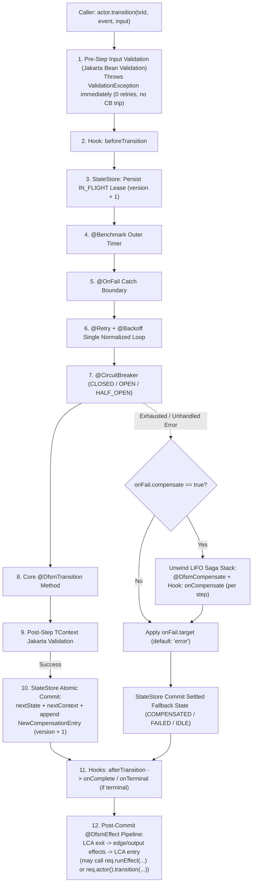

# DFSM Core — Java SDK (`io.github.eklabdev:dfsm-core`)

**XState-Aligned Durable Finite State Machine & Distributed Saga Orchestration Engine for Java 17+**

[](../../spec/SPECIFICATION.md)
[](#installation)
[](../../LICENSE)

`io.github.eklabdev:dfsm-core` is the official Java SDK for **DFSM (`eklabdev/dfsm`)**. It executes canonical `dfsm: "1.0"` YAML workflows and fluent `MachineBuilder<TContext>` definitions with full XState statechart semantics, GoF decorator resilience pipelines, **Jakarta Bean Validation**, LIFO Saga compensation, conditional `@DfsmEffect` routing, 6 lifecycle hooks (`@DfsmHook`), and pluggable durable persistence (**H2** in-memory default, **PostgreSQL**, and **MongoDB**).

---

## Table of Contents

1. [Installation (Maven & Gradle)](#1-installation-maven--gradle)
2. [Key Features](#2-key-features)
3. [Quickstart: YAML + Annotations + Jakarta Validation](#3-quickstart-yaml--annotations--jakarta-validation)
4. [Programmatic `MachineBuilder` & `TransitionDecoratorBuilder`](#4-programmatic-machinebuilder--transitiondecoratorbuilder)
5. [Execution Lifecycle: Decorators, Hooks, Saga & Conditional Effects](#5-execution-lifecycle-decorators-hooks-saga--conditional-effects)
6. [Durable State Stores (H2, PostgreSQL, MongoDB)](#6-durable-state-stores-h2-postgresql-mongodb)
7. [Operations, Active vs. Terminal Queries, Scheduler & Crash Recovery](#7-operations-active-vs-terminal-queries-scheduler--crash-recovery)
8. [Progressive Examples (`01` to `05`)](#8-progressive-examples-01-to-05)
9. [Running Tests & Conformance Suite](#9-running-tests--conformance-suite)
10. [Publishing Guide: Maven Central & JCenter / JFrog Artifactory](#10-publishing-guide-maven-central--jcenter--jfrog-artifactory)

---

## 1. Installation (Maven & Gradle)

### Apache Maven (`pom.xml`)

```xml
<dependency>
    <groupId>io.github.eklabdev</groupId>
    <artifactId>dfsm-core</artifactId>
    <version>1.0.0</version>
</dependency>
```

### Gradle Kotlin DSL (`build.gradle.kts`)

```kotlin
dependencies {
    implementation("io.github.eklabdev:dfsm-core:1.0.0")
}
```

> **Requirements:** Java **17** or newer (`17`, `21`, `25` LTS).

---

## 2. Key Features

- **Dual Authoring Modes**: Load cross-language `dfsm: "1.0"` YAML validated against the bundled Draft 2020-12 JSON Schema (`schemas/dfsm-v1.schema.json`), or build machines in pure Java with `MachineBuilder<TContext>`.
- **Full XState Statechart Semantics**: Atomic, compound (nested hierarchy with parent event bubbling), orthogonal `parallel` regions, `final` states, automatic `onDone` cascades, Lowest Common Ancestor (LCA) `exit` -> `entry` ordering, and implicit `final` `error` state injection (overridable with custom recovery transitions).
- **Annotations & Functional GoF Decorators**:
  - Method annotations: `@DfsmTransition`, `@DfsmCompensate`, `@DfsmEffect`, `@DfsmHook`, `@Retry`, `@Backoff`, `@CircuitBreaker`, `@OnFail`, `@CompensateWith`, `@Benchmark`.
  - Functional builder for lambdas: `TransitionDecoratorBuilder.of(...)`.
  - **Policy Normalization Deduplicator (`Code Decorator > YAML > Machine Defaults > Registry Defaults`)**: Prevents nested retry multiplication (`@Retry(4)` overriding YAML `retry: 3` runs **4** attempts total, never `4 * 3 = 12`, while inheriting YAML's `circuitBreaker`).
- **Pre-Flight Jakarta Bean Validation**: Automatic `@NotBlank`, `@Positive`, `@Email`, `@Min`, `@Valid` validation on generic `TContext` and `TInput` records/POJOs *before* retries, circuit breakers, or Saga compensation execute.
- **Distributed LIFO Saga Rollback**: Every committed step with a `compensate` handler pushes a durable snapshot (`fromState`, `inputSnapshot`, `contextBefore`) onto the transaction's Saga stack and unwinds in strict LIFO order upon `@OnFail(compensate = true)`.
- **Conditional `@DfsmEffect` Routing & Chaining**: Effects receive `EffectRequest<TContext>` with `req.runEffect(...)` and `req.actor().transition(...)` to act as `if / else` routers and drive automatic multi-step workflows (guarded by `maxEffectChainDepth`, default `25`).
- **6 Transaction Lifecycle Hooks (`@DfsmHook` & `ActorLifecycleHooks`)**: `onStart`, `beforeTransition`, `afterTransition`, `onCompensate`, `onComplete`, `onTerminal` — declarable in YAML (`hooks:`) and bound at machine creation via `MachineHandlerBindings`.
- **Pluggable Durable Stores**: Zero-config `H2StateStore` (default), `PostgresStateStore` (`JSONB` + transactional Saga table), and `MongoStateStore` (atomic document optimistic concurrency + embedded Saga stack).

---

## 3. Quickstart: YAML + Annotations + Jakarta Validation

```java
import io.github.eklabdev.dfsm.*;
import io.github.eklabdev.dfsm.ActorLifecycleHooks.OnTerminalEvent;
import io.github.eklabdev.dfsm.annotation.*;
import io.github.eklabdev.dfsm.runtime.*;
import jakarta.validation.constraints.*;

public class CheckoutQuickstart {

    public record OrderContext(String email, double total, boolean paid) {}
    public record SubmitInput(@NotBlank @Email String email, @Positive double total) {}

    public static class CheckoutService {
        @DfsmTransition("submitOrder")
        @CompensateWith("cancelOrder")
        public TransitionOutput<OrderContext, Void> submitOrder(TransitionRequest<OrderContext, SubmitInput> req) {
            return TransitionOutput.ofContext(new OrderContext(req.input().email(), req.input().total(), false));
        }

        @DfsmCompensate("cancelOrder")
        public void cancelOrder(CompensationRequest<OrderContext> req) {
            System.out.println("Rolled back order for tx: " + req.transactionId());
        }

        @DfsmTransition("chargeCard")
        @Retry(maxAttempts = 3)
        @OnFail(compensate = true, target = "error")
        public TransitionOutput<OrderContext, String> chargeCard(TransitionRequest<OrderContext, Void> req) {
            OrderContext c = req.data();
            return TransitionOutput.of(new OrderContext(c.email(), c.total(), true), "RECEIPT-1001");
        }

        @DfsmEffect("autoChargeIfSmall")
        public void autoChargeIfSmall(EffectRequest<OrderContext> req) {
            if (req.context().total() < 500.0) {
                req.actor().transition(req.transactionId(), "CHARGE", null);
            }
        }

        @DfsmHook("auditTerminal")
        public void auditTerminal(OnTerminalEvent<OrderContext> ev) {
            System.out.println("Tx " + ev.transactionId() + " settled in " + ev.status() + " @ " + ev.finalState());
        }
    }

    public static void main(String[] args) {
        String yaml = """
                dfsm: "1.0"
                id: quickstart-checkout
                version: "1.0.0"
                initial: draft
                registry:
                  namespace: checkout
                  strict: true
                hooks:
                  onTerminal: [auditTerminal]
                states:
                  draft:
                    on:
                      SUBMIT:
                        target: submitted
                        transition: submitOrder
                        compensate: cancelOrder
                  submitted:
                    entry: [autoChargeIfSmall]
                    on:
                      CHARGE:
                        target: completed
                        transition: chargeCard
                  completed:
                    type: final
                """;

        try (FSMRegistry registry = new FSMRegistry()) {
            registry.registerYaml(yaml, MachineHandlerBindings.ofServices(new CheckoutService()));
            DfsmActor<OrderContext> actor = registry.createActor("quickstart-checkout", OrderContext.class);

            String txId = actor.startTransaction(new OrderContext("init@example.com", 1.0, false));
            actor.transition(txId, "SUBMIT", new SubmitInput("alice@example.com", 129.99));

            // Because total < 500, entry effect 'autoChargeIfSmall' automatically chained CHARGE -> completed!
            var snapshot = actor.getTransaction(txId);
            System.out.println("Final State: " + snapshot.stateValue() + ", Status: " + snapshot.status());
        }
    }
}
```

---

## 4. Programmatic `MachineBuilder` & `TransitionDecoratorBuilder`

When you prefer pure Java over YAML (or want to compose policies around lambdas), use `MachineBuilder` and `TransitionDecoratorBuilder`:

```java
var advanceSignal = TransitionDecoratorBuilder
        .<TrafficContext, AdvanceInput, String>of(req -> {
            int next = req.data().cycles() + 1;
            return TransitionOutput.of(new TrafficContext(next), "cycle-" + next);
        })
        .named("recordAdvance")
        .inputType(AdvanceInput.class)
        .retry(3)
        .backoff(BackoffStrategy.EXPONENTIAL, 100, 1000, 2.0)
        .circuitBreaker(5, 10, 30_000, 1)
        .benchmark(true)
        .build();

MachineBuilder<TrafficContext> builder = MachineBuilder.<TrafficContext>create("traffic-light")
        .version("1.0.0")
        .namespace("traffic")
        .initial("red")
        .state("red", s -> s.on("NEXT", "green", "recordAdvance"))
        .state("green", s -> s.on("NEXT", "red", "recordAdvance"))
        .finalState("decommissioned");

registry.registerBuilder(builder, MachineHandlerBindings.builder()
        .transition("recordAdvance", advanceSignal)
        .build());
```

---

## 5. Execution Lifecycle: Decorators, Hooks, Saga & Conditional Effects

### 5.1 Policy Normalization & GoF Decorator Pipeline (Per Transition Step)

At actor initialization, `PolicyMerger` merges 4 layers (`Code Annotation/Builder > YAML Transition > YAML Machine Defaults > Registry Global Defaults`) into a single `NormalizedTransitionPolicy` and wraps the handler once:



### 5.2 Hook Precedence Order

When multiple hook sources are registered, every hook slot executes in deterministic outer-to-inner order:
1. **Global Registry Hooks** (`registry.addGlobalHooks(...)`)
2. **Machine YAML / Builder Hooks** (`hooks:` in YAML or `MachineBuilder.hook(...)` resolved via `@DfsmHook` / `registerHook`)
3. **Actor Config Hooks** (`ActorConfig.builder().hooks(...)`)
4. **Dynamic Actor Hooks** (`actor.addHooks(...)`, removable via the returned `Runnable`)

---

## 6. Durable State Stores (H2, PostgreSQL, MongoDB)

All 3 stores implement `io.github.eklabdev.dfsm.store.StateStore` with optimistic concurrency (`StaleTransactionVersionException` prevents split-brain zombie workers from overwriting state).

### 6.1 Default In-Memory Store: H2 (`H2StateStore`)

Used automatically by `new FSMRegistry()`:

```java
FSMRegistry registry = new FSMRegistry(); // Uses isolated in-memory H2 database out of the box
```

### 6.2 Production PostgreSQL (`PostgresStateStore`)

Uses `JSONB` columns, composite partial indexes, and transactional Saga stack tables (`<prefix>transactions` and `<prefix>compensations`):

```java
import io.github.eklabdev.dfsm.store.PostgresStateStore;

StateStore pgStore = new PostgresStateStore(
        "jdbc:postgresql://localhost:5432/orders_db",
        "dfsm_user",
        "secret_password",
        "dfsm_" // table prefix
);
FSMRegistry registry = new FSMRegistry(pgStore);
```

### 6.3 Production MongoDB (`MongoStateStore`)

Uses atomic `findOneAndUpdate` optimistic version checks (`version: expectedVersion`), embedded `compensationStack` arrays, and compound operational indexes:

```java
import io.github.eklabdev.dfsm.store.MongoStateStore;

StateStore mongoStore = new MongoStateStore(
        "mongodb://localhost:27017",
        "orders_db",
        "dfsm_transactions"
);
FSMRegistry registry = new FSMRegistry(mongoStore);
```

---

## 7. Operations, Active vs. Terminal Queries, Scheduler & Crash Recovery

```java
// 1. Non-Terminal ("Active") vs. Terminal Inspection
long activeOrders = actor.getActiveCount(); // IDLE + IN_FLIGHT + COMPENSATING
var activeList    = actor.listActiveTransactions(50, 0);
var breakdown     = actor.getStatusBreakdown(); // nonTerminalCount, terminalCount, byStatus
var terminals     = actor.getTerminalStates();  // topLevelTerminalStates, allFinalStatePaths, errorStateMode

// 2. Currently Executing ("In-Flight") & Stuck Lease Inspection
long inFlightNow  = actor.getInFlightCount();
var stuckList     = actor.listInFlightTransactions(DfsmModels.InFlightFilter.onlyStuck());
var globalSummary = registry.getInFlightSummary();

// 3. Background Recovery & Retention Scheduler
actor.updateSchedulerConfig(new DfsmModels.SchedulerConfig(
        true,     // enabled
        15_000L,  // sweepIntervalMs
        30_000L,  // stuckThresholdMs
        86_400_000L, // retentionMs (auto-purge terminal records older than 24h)
        100       // batchSize
));
var sweepReport = actor.triggerSweepNow(); // Recover stuck IN_FLIGHT via STOP | MARK_FAIL | DELETE | COMPENSATE | CONTINUE

// 4. Administrative Force Clean-Up (Supports Safe Dry-Run!)
var dryRun = actor.forceCleanUp(new DfsmModels.ForceCleanUpOptions(
        DfsmModels.ForceCleanUpAction.COMPENSATE,
        java.util.List.of(),
        true,  // includeInFlight
        true,  // stuckOnly
        null,  // olderThanMs
        true,  // dryRun
        100
));
```

---

## 8. Progressive Examples (`01` to `05`)

All 5 runnable examples live in [`src/main/java/io/github/eklabdev/dfsm/examples/`](src/main/java/io/github/eklabdev/dfsm/examples):

| # | Class | What It Demonstrates | Run Command |
|---|-------|----------------------|-------------|
| **01** | `Example01SimpleTrafficLight` | Fluent `MachineBuilder`, `TransitionDecoratorBuilder`, typed outputs, `entry`/`exit` effects | `./mvnw compile exec:java -Dexec.mainClass="io.github.eklabdev.dfsm.examples.Example01SimpleTrafficLight"` |
| **02** | `Example02YamlJakartaValidation` | `dfsm: "1.0"` YAML + `@DfsmTransition` + pre-flight Jakarta `@Email`/`@Positive`/`@Valid` rejection | `./mvnw compile exec:java -Dexec.mainClass="io.github.eklabdev.dfsm.examples.Example02YamlJakartaValidation"` |
| **03** | `Example03HierarchicalParallelWorkflow` | Compound parent `CANCEL` bubbling + orthogonal `parallel` regions + automatic `onDone` | `./mvnw compile exec:java -Dexec.mainClass="io.github.eklabdev.dfsm.examples.Example03HierarchicalParallelWorkflow"` |
| **04** | `Example04PolicyMergeAndSagaCompensation` | `@Retry(4)` overriding YAML `retry: 3` (single loop!) + YAML `circuitBreaker` + LIFO Saga rollback + `BenchmarkLogEngine` | `./mvnw compile exec:java -Dexec.mainClass="io.github.eklabdev.dfsm.examples.Example04PolicyMergeAndSagaCompensation"` |
| **05** | `Example05MultiActorOpsHooksAndRecovery` | YAML `hooks:`/`effects:`, conditional `@DfsmEffect` router (`runEffect` + `actor().transition`), active/terminal queries, crash recovery (`COMPENSATE`) & `forceCleanUp` | `./mvnw compile exec:java -Dexec.mainClass="io.github.eklabdev.dfsm.examples.Example05MultiActorOpsHooksAndRecovery"` |

---

## 9. Running Tests & Conformance Suite

```bash
# Start local PostgreSQL 17 (port 55432) & MongoDB 8.0 (port 27018) for live store integration tests
docker compose -f ../../infra/docker-compose.yml up -d

# Run all JUnit 5 unit tests, cross-language conformance scenarios, examples, and DB integration tests
./mvnw test
```

---

## 10. Publishing Guide: Maven Central & JCenter / JFrog Artifactory

`pom.xml` ships with pre-configured Maven profiles (`release`, `maven-central`, and `artifactory`) so you can publish signed artifacts (`dfsm-core-1.0.0.jar`, `-sources.jar`, `-javadoc.jar`, `.pom`, and `.asc` GPG signatures) with a single command.

### 10.1 Publishing to Maven Central (Sonatype Central Portal)

Maven Central requires:
1. Verified namespace ownership (`io.github.eklabdev` verified automatically via GitHub at <https://central.sonatype.com>).
2. Attached `-sources.jar` and `-javadoc.jar` (handled by `-P release`).
3. GPG-signed artifacts (`.asc` files, handled by `maven-gpg-plugin` in `-P release`).

#### Step 1: Generate & Publish Your GPG Key

```bash
# 1. Generate a 4096-bit RSA keypair
gpg --full-generate-key

# 2. List keys to copy your 40-char fingerprint / key ID
gpg --list-secret-keys --keyid-format=long

# 3. Distribute your public key to public keyservers verified by Sonatype Central
gpg --keyserver keyserver.ubuntu.com --send-keys <YOUR_GPG_KEY_ID>
gpg --keyserver keys.openpgp.org --send-keys <YOUR_GPG_KEY_ID>
```

#### Step 2: Configure `~/.m2/settings.xml` with Your Sonatype Central Portal Token

Sign in to <https://central.sonatype.com>, open **Account -> Generate User Token**, and add the token to `~/.m2/settings.xml`:

```xml
<settings xmlns="http://maven.apache.org/SETTINGS/1.0.0"
          xmlns:xsi="http://www.w3.org/2001/XMLSchema-instance"
          xsi:schemaLocation="http://maven.apache.org/SETTINGS/1.0.0 https://maven.apache.org/xsd/settings-1.0.0.xsd">
    <servers>
        <server>
            <!-- Matches <publishingServerId>central</publishingServerId> in pom.xml -->
            <id>central</id>
            <username>YOUR_CENTRAL_TOKEN_USERNAME</username>
            <password>YOUR_CENTRAL_TOKEN_PASSWORD</password>
        </server>
    </servers>

    <profiles>
        <profile>
            <id>gpg</id>
            <properties>
                <gpg.executable>gpg</gpg.executable>
                <gpg.passphrase>${env.MAVEN_GPG_PASSPHRASE}</gpg.passphrase>
            </properties>
        </profile>
    </profiles>
    <activeProfiles>
        <activeProfile>gpg</activeProfile>
    </activeProfiles>
</settings>
```

#### Step 3: Deploy & Auto-Publish to Maven Central

```bash
export GPG_TTY=$(tty)
export MAVEN_GPG_PASSPHRASE="your-gpg-passphrase"

./mvnw clean deploy -P release,maven-central
```

`central-publishing-maven-plugin` bundles the signed JARs, uploads them to Sonatype Central Portal, validates checksums + GPG signatures + POM metadata, and publishes `io.github.eklabdev:dfsm-core:1.0.0` to `repo.maven.apache.org`.

---

### 10.2 Publishing to JCenter / JFrog Artifactory

> **Important Note on Bintray JCenter:** JFrog sunsetted public Bintray JCenter submissions in 2021 and serves legacy JCenter as a read-only mirror. For modern public distribution, publish to **Maven Central** (Section 10.1 above — Gradle `mavenCentral()` resolves it natively). For enterprise/internal registries or JFrog Cloud repositories (the successor platform to JCenter), publish directly to **JFrog Artifactory** using the bundled `artifactory` profile below.

#### Step 1: Configure JFrog Artifactory Credentials in `~/.m2/settings.xml`

Create an **Identity Token** (or API Key) in your JFrog Platform UI (**User Profile -> Generate Identity Token**) and add both server entries to `~/.m2/settings.xml`:

```xml
<settings xmlns="http://maven.apache.org/SETTINGS/1.0.0">
    <servers>
        <server>
            <id>artifactory-releases</id>
            <username>YOUR_JFROG_USERNAME</username>
            <password>${env.JFROG_IDENTITY_TOKEN}</password>
        </server>
        <server>
            <id>artifactory-snapshots</id>
            <username>YOUR_JFROG_USERNAME</username>
            <password>${env.JFROG_IDENTITY_TOKEN}</password>
        </server>
    </servers>
</settings>
```

#### Step 2: Deploy Releases or Snapshots to JFrog Artifactory

```bash
export JFROG_IDENTITY_TOKEN="your-jfrog-identity-token"

# Option A: Signed release deployment (with sources, javadoc, and GPG signatures)
export GPG_TTY=$(tty)
export MAVEN_GPG_PASSPHRASE="your-gpg-passphrase"
./mvnw clean deploy -P release,artifactory \
  -Dartifactory.releases.url="https://your-org.jfrog.io/artifactory/libs-release-local" \
  -Dartifactory.snapshots.url="https://your-org.jfrog.io/artifactory/libs-snapshot-local"

# Option B: Internal Artifactory deployment without GPG signing
./mvnw clean deploy -P release,artifactory \
  -Dgpg.skip=true \
  -Dartifactory.releases.url="https://your-org.jfrog.io/artifactory/libs-release-local"
```

#### Alternative: Publishing with JFrog CLI (`jf`) + Build-Info Provenance

If your CI/CD pipeline uses JFrog CLI (for Xray vulnerability scanning and Artifactory Build-Info):

```bash
jf config add my-jfrog --url="https://your-org.jfrog.io" --access-token="$JFROG_IDENTITY_TOKEN"
jf mvn-config --repo-deploy-releases="libs-release-local" --repo-deploy-snapshots="libs-snapshot-local"
jf mvn clean install -P release -Dgpg.skip=true --build-name="dfsm-core" --build-number="1.0.0"
jf rt build-publish "dfsm-core" "1.0.0"
```

#### Consuming from JFrog Artifactory (Maven & Gradle)

```kotlin
// build.gradle.kts (replacing legacy jcenter() with mavenCentral() + Artifactory)
repositories {
    mavenCentral()
    maven {
        url = uri("https://your-org.jfrog.io/artifactory/libs-release")
        credentials {
            username = System.getenv("JFROG_USER")
            password = System.getenv("JFROG_IDENTITY_TOKEN")
        }
    }
}
```

