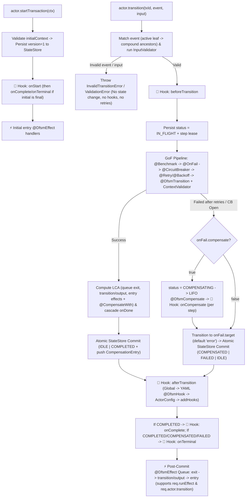

# `@eklabdev/dfsm` — Durable Finite State Machine SDK for TypeScript

`@eklabdev/dfsm` is the official TypeScript / Node.js runtime for **DFSM (`eklabdev/dfsm`)** — an XState-aligned **Durable Finite State Machine** and distributed **Saga orchestration** engine.

## Features

- **XState-Aligned Statecharts**: Standalone (`atomic`), hierarchical parent/child (`compound` with event bubbling and LCA `exit`/`entry` ordering), orthogonal concurrent regions (`parallel` + automatic `onDone`), and an implicit overridable `error` state.
- **Dual Authoring (`YAML` + `MachineBuilder`)**: Load canonical `.dfsm.yaml` definitions (shared identically across Java, C#, Go, Rust, and the VS Code Visualizer) or build machines in code via `createMachine<TContext>(id)`.
- **Code-First Typed Generics & Validation**: Keep untyped blobs out of YAML — define `<TContext, TInput, TOutput>` in TypeScript and attach **Zod** schemas (or custom `SchemaValidator<T>`) directly to Actors and Transitions.
- **Decorator Pattern & Deduplicated Policy Merging**: Use `@DfsmTransition`, `@Retry`, `@Backoff`, `@CircuitBreaker`, `@OnFail`, `@CompensateWith`, `@Benchmark` (compatible with **both** TC39 Stage-3 decorators and legacy `experimentalDecorators`) or functional `decorateTransition(fn, withRetry(...))`. Overlapping code and YAML policies normalize into a **single deduplicated GoF Decorator pipeline** (`Code Decorator > Transition YAML > Machine Defaults > SDK Default`).
- **Durable Multi-Actor & Saga LIFO Rollback**: Run multiple isolated `DfsmActor<TContext>` instances backed by built-in embedded SQLite (`node:sqlite` `:memory:` out of the box) or production **PostgreSQL** (`pg`) and **MongoDB** (`mongodb`) stores.
- **Operational Introspection, Recovery Scheduler & `forceCleanUp`**: Query loaded machines, effective merged policies, live in-flight/stuck counts, background recovery/retention scheduler status (`STOP`, `MARK_FAIL`, `DELETE`, `COMPENSATE`, `CONTINUE`), and execute optimistic-lock-safe `forceCleanUp`.

---

## Installation

```bash
npm install @eklabdev/dfsm

# Optional peer dependencies (install what your project uses):
npm install zod           # For Zod context & input validation
npm install pg            # For PostgreSQL durable state store
npm install mongodb       # For MongoDB durable state store
```

> **Node.js Requirement**: Node.js `>= 22.5.0` (uses built-in `node:sqlite` for zero-compilation embedded SQL `:memory:` persistence by default).

---

## Quick Start

### 1. Define Typed Context, Input Validation & Decorated Handlers

```typescript
import { z } from "zod";
import {
  CompensateWith,
  DfsmCompensate,
  DfsmEffect,
  DfsmTransition,
  FSMRegistry,
  OnFail,
  Retry,
  type CompensationRequest,
  type TransitionOutput,
  type TransitionRequest,
} from "@eklabdev/dfsm";

const OrderContextSchema = z.object({
  orderId: z.string(),
  inventoryReserved: z.boolean(),
  paid: z.boolean(),
});
type OrderContext = z.infer<typeof OrderContextSchema>;

const ChargeInputSchema = z.object({
  amountCents: z.number().int().positive(),
});
type ChargeInput = z.infer<typeof ChargeInputSchema>;

class CheckoutHandlers {
  @DfsmTransition("reserveStock")
  @CompensateWith("releaseStock")
  async reserveStock(
    req: TransitionRequest<OrderContext>
  ): Promise<TransitionOutput<OrderContext, string>> {
    return {
      context: { ...req.context.data, inventoryReserved: true },
      value: "RESERVED",
    };
  }

  @DfsmCompensate("releaseStock")
  async releaseStock(req: CompensationRequest<OrderContext>): Promise<OrderContext> {
    return { ...req.currentContext, inventoryReserved: false };
  }

  @DfsmTransition({ name: "chargeCard", inputValidator: ChargeInputSchema })
  @Retry(4) // Overrides YAML retry (e.g. 3) -> single retry loop of 4 attempts!
  @OnFail({ compensate: true, target: "error" })
  async chargeCard(
    req: TransitionRequest<OrderContext, ChargeInput>
  ): Promise<TransitionOutput<OrderContext, { receipt: string }>> {
    return {
      context: { ...req.context.data, paid: true },
      value: { receipt: `RCPT-${req.input.amountCents}` },
      effects: ["sendReceiptEmail"],
    };
  }

  @DfsmEffect("sendReceiptEmail")
  async sendReceiptEmail(): Promise<void> {
    // Post-commit side effect
  }
}
```

### 2. Load YAML (or `MachineBuilder`) into Singleton `FSMRegistry` & Run an `Actor`

```typescript
const registry = FSMRegistry.getInstance();
registry.registerService(new CheckoutHandlers(), "orders.checkout");

registry.registerYaml(`
dfsm: "1.0"
id: order-checkout
initial: pending
registry:
  namespace: "orders.checkout"
  strict: true
states:
  pending:
    on:
      RESERVE:
        target: reserved
        transition: reserveStock
        compensate: releaseStock
  reserved:
    on:
      PAY:
        target: completed
        transition: chargeCard
        retry:
          maxAttempts: 3
        circuitBreaker:
          enabled: true
          failureThreshold: 5
  completed:
    type: final
`);

const orderActor = await registry.createActor<OrderContext>("order-checkout", {
  contextValidator: OrderContextSchema,
  recovery: {
    enabled: true,
    stuckThresholdMs: 30_000,
    defaultAction: "COMPENSATE", // STOP | MARK_FAIL | DELETE | COMPENSATE | CONTINUE
  },
  scheduler: {
    enabled: true,
    sweepIntervalMs: 15_000,
    stuckThresholdMs: 30_000,
    retentionMs: 86_400_000,
  },
});

// Immediately persists initial state + context to StateStore
const txId = await orderActor.startTransaction({
  orderId: "ORD-1001",
  inventoryReserved: false,
  paid: false,
});

await orderActor.transition(txId, "RESERVE");
const payRes = await orderActor.transition<ChargeInput, { receipt: string }>(txId, "PAY", {
  amountCents: 4999,
});

console.log(payRes.currentState, payRes.status, payRes.value);
// -> "completed", "COMPLETED", { receipt: "RCPT-4999" }

await registry.shutdown();
```

---

## Functional Decorator Alternative (No Classes Required)

Prefer plain functions over class methods? Use `decorateTransition`:

```typescript
import {
  decorateTransition,
  withBackoff,
  withCircuitBreaker,
  withOnFail,
  withRetry,
} from "@eklabdev/dfsm";

const resilientHandler = decorateTransition(
  async ({ currentState, input, context }) => ({
    value: "OK",
    context: context.data,
  }),
  withRetry(4),
  withBackoff({ strategy: "exponential_jitter", initialDelayMs: 100, maxDelayMs: 2000 }),
  withCircuitBreaker({ failureThreshold: 5, openDurationMs: 30_000 }),
  withOnFail({ compensate: true, target: "error" })
);

registry.registerTransition("myNamespace.resilientHandler", resilientHandler);
```

---

## Pluggable Durable Stores

Out of the box, `FSMRegistry` defaults to `new SqliteStateStore({ filename: ":memory:" })`. Swap to file-backed SQLite, **PostgreSQL**, or **MongoDB** globally or per Actor:

```typescript
import { FSMRegistry, MongoStateStore, PostgresStateStore, SqliteStateStore } from "@eklabdev/dfsm";

// 1. Embedded SQLite (in-memory or persistent file)
const sqliteStore = new SqliteStateStore({ filename: ":memory:" });

// 2. PostgreSQL (JSONB + transactional compensation stack + composite indexes)
const pgStore = new PostgresStateStore({
  connectionString: process.env.DATABASE_URL,
  tablePrefix: "dfsm_",
});

// 3. MongoDB (Atomic document optimistic locking + embedded compensation stack)
const mongoStore = new MongoStateStore({
  uri: process.env.MONGO_URL,
  databaseName: "workflows",
});

FSMRegistry.getInstance().configure({ store: pgStore });
```

---

## Conditional Effect Routing (`req.actor` + `req.runEffect`) & YAML-Defined Lifecycle Hooks (`@DfsmHook`)

`@DfsmEffect` handlers receive `req.actor` and `req.runEffect(...)`, allowing any `entry`, `exit`, or post-step effect to act as an `if / else` router and immediately trigger automatic next transitions on the same actor without needing `always:` in YAML.

All 6 transaction lifecycle hooks (`onStart`, `beforeTransition`, `afterTransition`, `onCompensate`, `onComplete`, `onTerminal`), routed sub-effects (`effects:`), and `maxEffectChainDepth` can be declared directly in **YAML** (or `MachineBuilder`) and registered + strictly validated right on **FSM machine creation**:

```typescript
class UnderwritingService {
  @DfsmEffect("routeByScore")
  async routeByScore(req: EffectRequest<{ score: number }>) {
    if (req.context.score >= 750) {
      await req.runEffect("fastTrackEffect", { tier: "prime" });
    } else {
      await req.actor.transition(req.transactionId, "QUEUE_MANUAL_REVIEW");
    }
  }

  @DfsmEffect("fastTrackEffect")
  async fastTrackEffect(req: EffectRequest<{ score: number }>) {
    await req.actor.transition(req.transactionId, "AUTO_APPROVE", req.payload);
  }

  @DfsmHook("onLoanStarted")
  onLoanStarted(e: OnTransactionStartHookEvent<{ score: number }>) {
    console.log("Started:", e.transactionId, e.initialState);
  }

  @DfsmHook("onLoanTerminal")
  onLoanTerminal(e: OnTerminalHookEvent<{ score: number }>) {
    console.log("Terminal:", e.status, e.finalState);
  }
}

// Register YAML + @DfsmTransition/@DfsmCompensate/@DfsmEffect/@DfsmHook together on machine creation
// (immediately validates all referenced transitions, compensations, routed effects, and hooks under strict: true!)
registry.registerYaml(
  `
dfsm: "1.0"
id: loan-machine
initial: scored
maxEffectChainDepth: 25
registry:
  namespace: "loans"
  strict: true
effects:
  - fastTrackEffect
hooks:
  onStart: onLoanStarted
  onTerminal: [onLoanTerminal]
states:
  scored:
    entry: [routeByScore]
    on:
      AUTO_APPROVE:
        target: approved
      QUEUE_MANUAL_REVIEW:
        target: manual_review
  manual_review:
    on:
      APPROVE:
        target: approved
  approved:
    type: final
`,
  { services: [new UnderwritingService()] }
);

const actor = await registry.createActor<{ score: number }>("loan-machine");
```

### Execution Flow: Transitions, Decorators, Hooks & Effects

1. **Policy Deduplication & GoF Decorator Wrapping (`Outer -> Inner`)**:
   - Policies merge leaf-by-leaf with precedence **`Code Decorator > Transition YAML > Machine Defaults > SDK Default`**, creating **one** wrapper per capability:
   - `InputValidator` → `BenchmarkDecorator (@Benchmark)` → `FallbackCompensateDecorator (@OnFail)` → `CircuitBreakerDecorator (@CircuitBreaker)` → `RetryBackoffDecorator (@Retry + @Backoff)` → `UserFunctionComponent (@DfsmTransition + ContextValidator)`.
2. **Exact Step & Hook Trigger Order**:



| Hook (`@DfsmHook` / `hooks:`) | When It Triggers | DB State Guaranteed |
| :--- | :--- | :--- |
| **`onStart`** | Right after `startTransaction()` writes initial record, before initial `entry` effects | `version = 1` persisted |
| **`beforeTransition`** | Right after event match + `InputValidator` pass, before `IN_FLIGHT` lease & `@DfsmTransition` | Previous settled state |
| **`onCompensate`** | After **each** LIFO `@DfsmCompensate` handler finishes & marks its stack entry compensated | `status = COMPENSATING`, entry marked `compensatedAt` |
| **`afterTransition`** | Immediately after the step's state & context commit to `StateStore` (**before** post-step effects) | New state & context durable in DB |
| **`onComplete`** | Immediately after `afterTransition` when settled `status === "COMPLETED"` | Non-`error` `final` state durable |
| **`onTerminal`** | Immediately after `afterTransition` (and `onComplete`) when `status` is `COMPLETED`, `COMPENSATED`, or `FAILED` | Terminal outcome durable |

---

## Operational Introspection, Non-Terminal Queries, Scheduler Control & `forceCleanUp`

```typescript
// Registry-wide inspection
const machines = registry.listMachines();
const effective = registry.getEffectiveConfig("order-checkout");
const handlers = registry.listRegisteredHandlers("orders.checkout");
const globalSummary = await registry.getInFlightSummary();

// Non-Terminal ("Active / Open" = IDLE + IN_FLIGHT + COMPENSATING) & Terminal State inspection
const activeCount = await orderActor.getActiveCount();
const activeOrders = await orderActor.listActiveTransactions({ limit: 50 });
const breakdown = await orderActor.getStatusBreakdown();
const terminalStates = orderActor.getTerminalStates();

// Step-level lease / stuck inspection & scheduler management
const inFlightCount = await orderActor.getInFlightCount({ stuckOnly: true });
const schedStatus = orderActor.getSchedulerStatus();
orderActor.updateSchedulerConfig({ sweepIntervalMs: 10_000, enabled: true });
const sweepReport = await orderActor.triggerSweepNow();

// Administrative force cleanup (supports dryRun, DELETE, MARK_FAIL, COMPENSATE, FORCE_UNLOCK)
const dryReport = await orderActor.forceCleanUp({
  statuses: ["COMPLETED", "FAILED", "COMPENSATED"],
  olderThanMs: 3_600_000,
  dryRun: true,
});
```

---

## Progressive Examples (`examples/01` -> `06`)

Run any example directly with `npx tsx`:

| Example | Features Covered | Command |
| :--- | :--- | :--- |
| [`examples/01-simple-traffic-light.ts`](./examples/01-simple-traffic-light.ts) | Standalone states via `MachineBuilder`, typed outputs, `entry` & post-commit effects | `npx tsx examples/01-simple-traffic-light.ts` |
| [`examples/02-yaml-typed-validation.ts`](./examples/02-yaml-typed-validation.ts) | YAML loading, `@DfsmTransition` decorators, **Zod** `TContext` & `TInput` validation | `npx tsx examples/02-yaml-typed-validation.ts` |
| [`examples/03-hierarchical-parallel-workflow.ts`](./examples/03-hierarchical-parallel-workflow.ts) | Compound parent/child event bubbling + orthogonal `parallel` regions + `onDone` | `npx tsx examples/03-hierarchical-parallel-workflow.ts` |
| [`examples/04-policy-merge-and-saga-compensation.ts`](./examples/04-policy-merge-and-saga-compensation.ts) | Decorator + YAML policy deduplication, LIFO Saga rollback, custom `error` override, `BenchmarkLogEngine` | `npx tsx examples/04-policy-merge-and-saga-compensation.ts` |
| [`examples/05-multi-actor-ops-and-recovery.ts`](./examples/05-multi-actor-ops-and-recovery.ts) | Multi-Actor isolation, live in-flight metrics, scheduler sweeps, recovery modes, `forceCleanUp` | `npx tsx examples/05-multi-actor-ops-and-recovery.ts` |
| [`examples/06-express-api-server/`](./examples/06-express-api-server/README.md) | Full end-to-end **Express REST API** with `.dfsm.yaml`, 1-by-1 HTTP transitions, live FSM status + YAML responses, Saga rollback & admin endpoints | `npm run start:api` |

---

## Running Tests

```bash
# Fast unit + progressive examples + canonical cross-language conformance suite
npm run test:unit

# Start local PostgreSQL 17 & MongoDB 8 containers and run full test matrix
docker compose -f ../../infra/docker-compose.yml up -d
npm test
```

---

## Publishing `@eklabdev/dfsm` to npm

### Prerequisites
1. Create or join the **`@eklabdev`** organization on [npmjs.com](https://www.npmjs.com/).
2. Generate a Granular Access Token (with **Read and write** permissions for `@eklabdev` packages and **Bypass 2FA** if publishing from CI).

### Local Manual Publish
```bash
cd sdks/typescript

# 1. Authenticate with npm
npm login --scope=@eklabdev

# 2. Verify strict typechecking, unit + conformance tests, dual ESM/CJS build, and tarball contents
npm run typecheck
npm run test:unit
npm run build
npm pack --dry-run

# 3. Bump semantic version (patch | minor | major)
npm version patch

# 4. Publish scoped package publicly
npm publish --access public
```

### Automated GitHub Actions Publish (with Provenance)
Create `.github/workflows/publish-npm.yml`:

```yaml
name: Publish @eklabdev/dfsm to npm
on:
  release:
    types: [published]

jobs:
  publish:
    runs-on: ubuntu-latest
    defaults:
      run:
        working-directory: sdks/typescript
    permissions:
      contents: read
      id-token: write # Required for npm cryptographic provenance
    steps:
      - uses: actions/checkout@v4
      - uses: actions/setup-node@v4
        with:
          node-version: "22"
          registry-url: "https://registry.npmjs.org"
      - run: npm ci
      - run: npm run prepublishOnly
      - run: npm publish --access public --provenance
        env:
          NODE_AUTH_TOKEN: ${{ secrets.NPM_TOKEN }}
```

